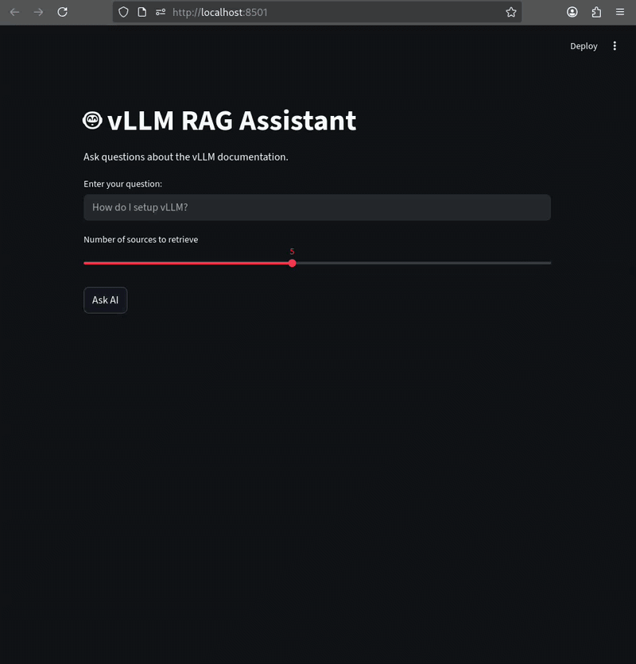

*This project has been created as part of the 42 curriculum by sudas.*

# RAG Against the Machine



## Description

**Goal.** Build a Retrieval-Augmented Generation (RAG) system that answers questions about a codebase. The target is the [vLLM](https://github.com/vllm-project/vllm) 0.10.1 repository. Given a question, the system:

1. retrieves the most relevant snippets (a file path plus a character range),
2. gives them to a small local model (`Qwen/Qwen3-0.6B`),
3. returns an answer grounded in those snippets.

**Overview.** Retrieval quality is measured with recall@k against ground-truth source locations, on a documentation dataset and a code dataset. A source counts as found when the file path matches exactly and the character ranges overlap with IoU >= 0.05. Required thresholds at k=5: 80% (docs) and 50% (code).

**Features**
- Two chunking strategies (code and Markdown/text)
- Lexical (BM25), semantic (ChromaDB + MiniLM) and hybrid (RRF) retrieval
- Grounded answer generation with Qwen3-0.6B
- CLI built with Python Fire, with progress bars (tqdm)
- Bonuses: semantic embeddings, hybrid retrieval, incremental indexing, caching, local HTTP API (FastAPI) with a Streamlit frontend

## Instructions

**Requirements:** Python 3.10+ and [uv](https://docs.astral.sh/uv/).

```bash
uv sync          # install dependencies
make install     # same, via the Makefile
make lint        # flake8 + mypy
make clean       # remove caches
```

**Expected layout** (data is not committed):

```
data/raw/vllm-0.10.1/                         # corpus
data/datasets/UnansweredQuestions/            # questions
data/datasets/AnsweredQuestions/              # ground truth
data/processed/                               # index (generated)
data/output/search_results/<DatasetScope>/    # search output (generated)
data/output/search_results_and_answer/<DatasetScope>/
```

**Full pipeline**

```bash
uv run python -m src index --max_chunk_size 2000
uv run python -m src search_dataset \
  --dataset_path data/datasets/UnansweredQuestions/dataset_docs_public.json \
  --k 10 \
  --save_directory data/output/search_results/UnansweredQuestions
./moulinette evaluate_student_search_results \
  data/output/search_results/UnansweredQuestions/dataset_docs_public.json \
  data/datasets/AnsweredQuestions/dataset_docs_public.json \
  --k 10 --max_context_length 2000
uv run python -m src answer_dataset \
  --student_search_results_path data/output/search_results/UnansweredQuestions/dataset_docs_public.json \
  --save_directory data/output/search_results_and_answer/UnansweredQuestions
```

**CLI commands**

| Command | Purpose |
|---|---|
| `index --max_chunk_size N [--method lexical\|semantic\|hybrid]` | Chunk the corpus and build the index |
| `search --query Q --k K` | Top-k sources for one query |
| `search_dataset --dataset_path P --k K --save_directory D` | Search a whole dataset |
| `answer --question Q --k K` | Retrieve and answer one question |
| `answer_dataset --student_search_results_path P --save_directory D` | Answer a whole results file |
| `evaluate --student_search_results_path P --dataset_path G --k K` | Own recall@k (the official score comes from the moulinette) |

Invalid input (empty query, `k=0`, missing file, malformed JSON) prints `Error: ...` and exits with code 1, never a traceback.

**API and frontend (bonus)**

```bash
uv run uvicorn src.api.main:app --port 8000     # terminal 1: backend
uv run streamlit run src/frontend/app.py         # terminal 2: http://localhost:8501
```

- `POST /sources` returns the retrieved sources only (fast, no LLM).
- `POST /ask` returns the sources and a generated answer. The first call loads the model and takes a minute or two.

**Tests**

```bash
uv run pytest tests/test_cli_errors.py -q
uv run pytest tests/test_retrieval.py -q -s
```

## Example usage

```bash
$ uv run python -m src search --query "How to configure the OpenAI server?" --k 3
Matching Resources
data/raw/vllm-0.10.1/docs/serving/openai_compatible_server.md[9867:10100]
...

$ uv run python -m src answer --question "What HTTP endpoint loads a LoRA adapter dynamically?" --k 5
Answer: ...

$ curl -X POST localhost:8000/sources -H "Content-Type: application/json" \
    -d '{"question": "How to load a LoRA adapter?", "k": 3}'
```

If the context does not contain the answer, the model is instructed to reply `I cannot find this in the provided context.`

## System architecture

```
Corpus -> Chunking -> Index (BM25 / ChromaDB) -> Retrieval -> Augmentation -> Qwen3-0.6B -> JSON answer
                                                     |
                                                  Evaluation (recall@k)
```

| Stage | Component | Role |
|---|---|---|
| Chunking | `chunk_data.py` | Split files, record exact character offsets |
| Indexing | `lexical_retriever.py`, `semantic_retriever.py` | BM25 index and Chroma collection under `data/processed/` |
| Retrieval | `abstract_classes.py`, `hybrid_retriever.py` | One interface for lexical, semantic and hybrid search |
| Augmentation | `pre_prompt.py`, `answer.py` | Top 3 chunks, best last, numbered blocks plus a grounding rule |
| Generation | `qwen3__0_6B.py`, `answer.py` | Greedy decoding, float32 on CPU |
| Speed | `cache.py` | Index digest and query/answer cache |
| Interfaces | `__main__.py`, `api/`, `frontend/` | CLI, HTTP API, Streamlit UI |

Data exchanged between stages uses pydantic models (`MinimalSource`, `MinimalSearchResults`, `StudentSearchResults`, ...).

## Chunking strategy

- **Python/code files:** LangChain `RecursiveCharacterTextSplitter.from_language`, which cuts at class and function boundaries first.
- **Markdown/text files:** the same splitter with paragraph, line, then word separators.
- **Size:** `--max_chunk_size` (default 2000). No chunk may exceed 2000 characters, otherwise the whole output is invalid.
- **Overlap:** 50 characters when `max_chunk_size >= 500`, otherwise 0.
- **Offsets:** each chunk stores `first_character_index` and `last_character_index` (end exclusive), and its id is `path:first:last`. Files are read as raw UTF-8 without newline translation, so offsets match the file on disk.

## Retrieval method

- **Lexical (BM25, `bm25s`):** scores chunks by keyword overlap. Rare terms weigh more, term frequency saturates, and long chunks are discounted. English stop words are removed at indexing and query time. Strong on exact identifiers and flags.
- **Semantic (ChromaDB + `all-MiniLM-L6-v2`):** chunks and queries are embedded and the nearest vectors are returned. It handles paraphrases, but a general English model is weak on code identifiers, and MiniLM truncates long inputs (about 256 tokens).
- **Hybrid (Reciprocal Rank Fusion):** both rankings are merged with `score = sum 1 / (60 + rank)`. Only ranks are used, because BM25 scores and Chroma distances are on incompatible scales. A chunk found by both methods is boosted.

## Performance analysis

Official metric: moulinette recall@k (same file and IoU >= 0.05).

**Documentation dataset (chunk size 2000, overlap 50)**

| Method | R@1 | R@3 | R@5 | R@10 | Latency/query |
|---|---|---|---|---|---|
| BM25 | 60.0% | 79.0% | **84.0%** | 93.0% | ~0.25 s |
| MiniLM (semantic) | 29.0% | 42.0% | 49.0% | 55.0% | ~1.2 s |
| Hybrid RRF | 43.0% | 67.0% | 77.0% | 86.0% | ~1.35 s |

**Code dataset (chunk size 2000, overlap 50)**

| Method | R@1 | R@3 | R@5 | R@10 | Latency/query |
|---|---|---|---|---|---|
| BM25 | 29.3% | 48.5% | **54.5%** | 57.6% | ~0.25 s |
| MiniLM (semantic) | 19.0% | 28.0% | 37.0% | 48.0% | ~1.2 s |
| Hybrid RRF | 27.0% | 44.0% | 53.0% | 67.0% | ~1.3 s |

<!-- TODO: replace the semantic and hybrid rows with fresh moulinette numbers. -->

**Observations**
- BM25 alone passes both thresholds at k=5 (84% docs, 54.5% code), so it is the default method.
- On docs, fusion does not beat BM25: the semantic ranking adds noise.
- On code, hybrid gains at k=10 (67% vs 57.6%) but not at k=5.
- Because the overlap bar is low (IoU 0.05), chunk size matters: a large chunk that only partly overlaps a short reference span fails quickly.

**System performance**

| Item | Limit | Measured |
|---|---|---|
| Indexing (cold) | <= 5 min | TODO |
| Indexing (nothing changed, incremental) | n/a | ~16 s |
| 200 questions retrieval | <= 90 s | TODO |
| Answer generation (CPU, float32) | none | ~16 s per question |

## Design decisions

- **BM25 as the default:** the simplest method that clears both thresholds. Hybrid and semantic are opt-in.
- **RRF over score fusion:** no weight tuning, robust to different score scales.
- **Stable chunk ids (`path:first:last`)** instead of list positions, so changing one file does not shift every other chunk.
- **Incremental indexing:** a manifest stores each file's SHA-256 and chunks. Only added or changed files are re-chunked and re-embedded, and deleted files are removed from Chroma. A change of settings resets everything. BM25 is rebuilt from the manifest (seconds); embeddings are the expensive part that is saved.
- **Caching:** an index digest (file mtime and size plus settings) skips work when nothing changed, and a persistent query/answer cache avoids repeated retrieval and generation.
- **float32 on CPU:** float16 generation was about 10x slower on the development CPU (174 s vs 16 s per question).
- **Grounded prompt:** numbered context passages, a rule to answer only from them, a fixed refusal sentence, and greedy decoding (`do_sample=False`) to reduce invented details.
- **Context cutoff of 3, best chunk last:** retrieval returns k sources (k=10 in the evaluation) for recall scoring, but the language model only sees the top 3, ordered from third-best to best. Reasons: a small model uses the end of the prompt best, a shorter prompt is faster on CPU (generation time grows with prompt length) and fits an 8 GB machine, and recall@3 already covers most of the answerable cases (TODO: docs and code recall@3 from your final tables). Progressive escalation (send chunk 1, then 1+2, then 1+2+3 on a refusal) was considered and rejected: it can cost more prefill on code, where recall@1 is low, and a wrong answer does not trigger a retry, only a refusal does.
- **Validation before work:** the CLI checks arguments and paths before loading any model.

## Challenges faced

- **Offsets that did not match the file.** JSON files were chunked from their Python `repr` and CRLF files shifted offsets. Fix: read raw UTF-8 with `newline=''` and chunk the real text, and check by slicing each file with the stored offsets.
- **Evaluator mismatch.** My own recall was higher than the moulinette's because it only compared file paths. Fix: apply the same rule (same file, IoU >= 0.05, per source). The numbers now match exactly.
- **Stale vector store.** Re-indexing with a different chunk size left old chunks in Chroma, and "remove" used `upsert`. Fix: a reset flag that drops the collection, `delete` for removed ids, and a count check after indexing.
- **Slow generation.** 4 minutes per answer on CPU. Fix: float32 instead of float16, no thinking mode, capped output.
- **Weak semantic recall on code.** A general English model embeds identifiers poorly. Hybrid fusion helps only at larger k.
- **Over-refusal with a long context.** With 10 retrieved chunks (about 20,000 characters) in the prompt, Qwen3-0.6B answered "I cannot find this in the provided context" even when the answer was present. I tested this by adding a short sun/moon text to the corpus: with k=10 the model refused, with k=2 it answered correctly. The relevant passage was diluted by the other chunks, and the small model also tends to lose information in a long context. Fix: only the top 3 chunks go into the prompt, in reverse order so the best chunk is last, right before the question. All k sources are still returned for retrieval scoring. TODO: result on N answerable questions (correct / wrong refusal / invented details), before and after.

## Resources

**Documentation and tools**
- [LangChain text splitters](https://python.langchain.com/docs/concepts/text_splitters/)
- [ChromaDB documentation](https://docs.trychroma.com/)
- [bm25s](https://github.com/xhluca/bm25s)
- [all-MiniLM-L6-v2](https://huggingface.co/sentence-transformers/all-MiniLM-L6-v2)
- [Qwen3-0.6B](https://huggingface.co/Qwen/Qwen3-0.6B)
- [FastAPI](https://fastapi.tiangolo.com/), [Streamlit](https://docs.streamlit.io/), [Pydantic](https://docs.pydantic.dev/), [Python Fire](https://github.com/google/python-fire)

**RAG references**
- [Microsoft Azure: Design and develop a RAG solution](https://learn.microsoft.com/en-us/azure/architecture/ai-ml/guide/rag/rag-solution-design-and-evaluation-guide)
- [Applied AI: Enterprise RAG architecture](https://www.applied-ai.com/briefings/enterprise-rag-architecture/)
- [Building production-ready RAG systems](https://medium.com/@meeran03/building-production-ready-rag-systems-best-practices-and-latest-tools-581cae9518e7)

**How AI was used**

| Task | Part of the project |
|---|---|
| Explaining concepts (RAG, BM25, IoU, RRF, caching, hashing) | Design phase |
| Code review and debugging help | Chunking, indexing, retrieval, cache, CLI |
| Docstrings | All Python modules |
| Drafting tests | `tests/test_cli_errors.py`, `tests/test_retrieval.py` |
| Drafting the Streamlit frontend and API endpoints | `src/frontend/`, `src/api/` |
| Polishing this README | `README.md` |

All AI output was reviewed, tested and understood before use.
